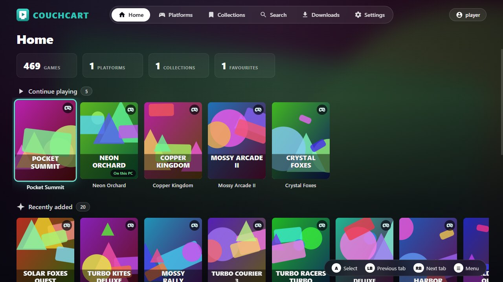
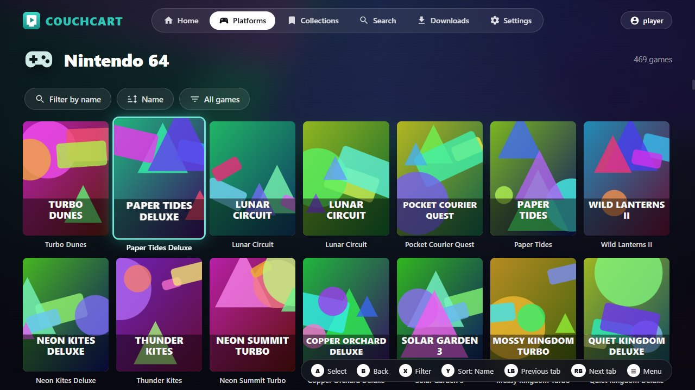
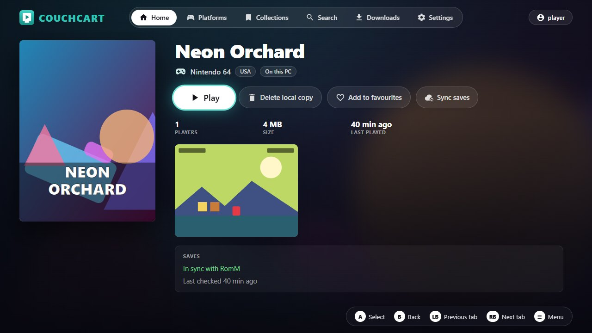
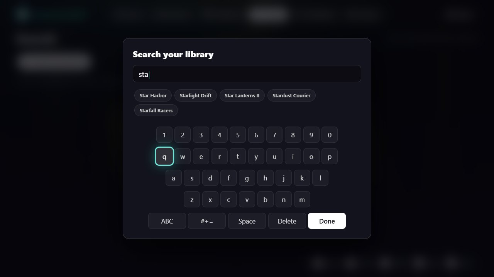
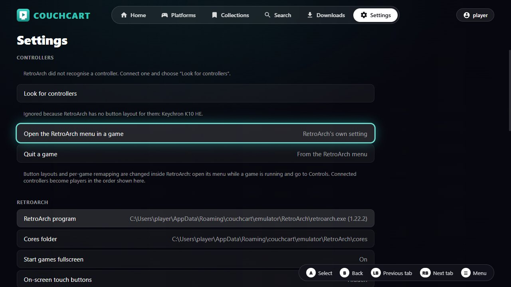
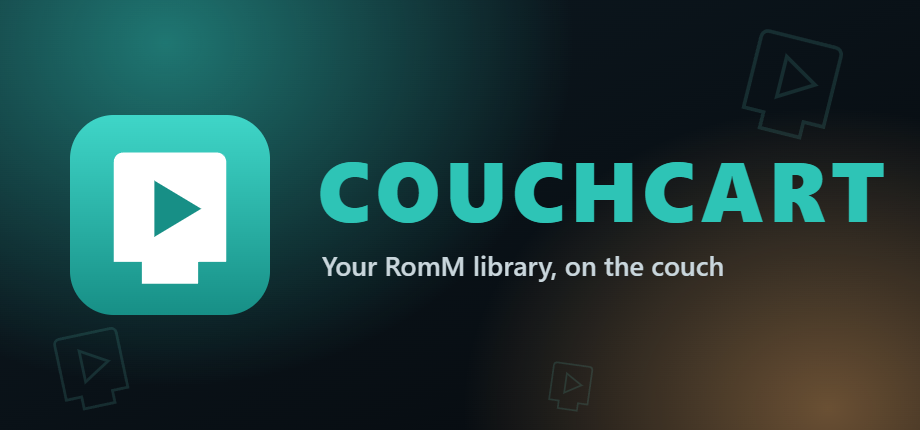

<div align="center">
  

  <h1>Couchcart</h1>

  <h3>Your RomM library, on the couch, with a controller.</h3>

  <p>
    <a href="https://github.com/darkmariachi/couchcart/actions/workflows/ci.yml"></a>
    
    
    <a href="LICENSE"></a>
  </p>
</div>

# Overview

Couchcart is a desktop launcher for a self-hosted [RomM](https://romm.app) library, made for a TV
and a gamepad. Pick a game, press Play, and carry on from the same save on any PC.

It is a launcher and save-sync client. [RetroArch](https://www.retroarch.com) does all the
emulation. Couchcart bundles no emulator, no cores and no games: it uses a RetroArch you already
have, or, on Windows, downloads RetroArch and the cores you need from libretro when you ask it
to.

<p align="center">
  
</p>

## Features

- Browse platforms, collections and favourites with cover art, by gamepad, keyboard or mouse
- Search the whole library, with games suggested as you type
- Press Play: the game downloads the first time and starts in RetroArch with a suitable core
- Saves and save states sync with RomM before a game starts and after it exits, with backups
  and a prompt instead of an overwrite when two PCs disagree
- Sign in by scanning a QR code or entering a short code, so no password is typed with a gamepad
- Controllers are assigned to players for you, even when a keyboard pretends to be a gamepad
- Keeps working offline for downloaded games, and uploads progress later
- Runs from Steam Big Picture as a non-Steam game
- No telemetry, no account besides your own RomM server

## Screenshots

<table>
  <tr>
    <td width="50%"></td>
    <td width="50%"></td>
  </tr>
  <tr>
    <td align="center"><sub>A platform, filtered and sorted with X and Y</sub></td>
    <td align="center"><sub>A game's page, with its save status</sub></td>
  </tr>
  <tr>
    <td></td>
    <td></td>
  </tr>
  <tr>
    <td align="center"><sub>Search suggests games as you type</sub></td>
    <td align="center"><sub>Settings, all reachable with a controller</sub></td>
  </tr>
</table>

<sub>The games and artwork in these screenshots are invented. Covers in the app come from your own
RomM server.</sub>

## Contents

- [Requirements](#requirements) · [Install](#install) · [First run](#first-run) ·
  [Controls](#controls)
- [Library](#library) · [Controllers](#controllers) · [Saves](#saves) ·
  [Downloaded games](#downloaded-games)
- [Adding it to Steam](#adding-it-to-steam) · [Settings](#settings) ·
  [Where things are stored](#where-things-are-stored) · [Troubleshooting](#troubleshooting)
- [Relationship to other projects](#relationship-to-other-projects) ·
  [Development](#development)

## Requirements

- A RomM server, version 5.x. Developed against 5.4.0.
- RetroArch, with a core for each platform you want to play. On Windows the setup wizard can
  download both for you. An existing install is found automatically: the standalone build, the
  Steam version and, on Linux, a distribution package or the Flatpak.
- Windows 10 or 11, or 64-bit Linux.

## Install

Download a file from a release, or build it yourself (see [Building](#building)).

**Windows**

- `Couchcart-<version>-setup.exe` installs for the current user and adds a Start menu entry.
- `Couchcart-<version>-portable.exe` runs without installing.

The builds are not code-signed, so Windows SmartScreen shows a warning the first time. Choose
"More info", then "Run anyway".

**Linux**

- `Couchcart-<version>-x86_64.AppImage`: make it executable (`chmod +x`) and run it.
- `Couchcart-<version>-x64.tar.gz`: unpack anywhere and run `couchcart` inside.

The Linux build is new and has had far less use than the Windows one. Your session is stored
through the desktop keyring (GNOME Keyring, KWallet or another Secret Service provider). Without
one, Couchcart still works but asks you to sign in again each time it starts, rather than write
a token to disk unprotected.

All builds, and a development run, use the same data folder, so you can switch between them
without setting anything up again.

## First run

The setup wizard asks for:

1. **Your RomM address**, for example `https://romm.example.lan`. "Find my server" looks for
   RomM on your network, on its default port (8080). A server on another port, or behind a web
   address, has to be typed in.
2. **Signing in.** Couchcart shows a QR code and a short code. Scan it, or open the address
   shown on a phone or computer where you are already signed in to RomM, and approve the request
   there. "Sign in with a password instead" is the fallback. Either way only a session token is
   stored, encrypted by the operating system; a password is never saved.
3. **RetroArch.** It is found automatically in the usual places, including Steam libraries. If
   it is not on the PC, "Set up RetroArch for me" downloads it from libretro (about 200 MB) into
   Couchcart's own folder; this is offered on Windows. The wizard then lists each platform in
   your library and whether a core for it is installed, and "Download the missing cores" fetches
   the ones that are not.
4. **Where to keep downloaded games**, with the free space on that drive.
5. **Existing saves.** If RetroArch already has saves for games in your library, the launcher
   offers to copy them in so you continue where you left off. RetroArch's own files are not
   touched.

## Controls

| Controller         | Keyboard             | Action                                    |
| ------------------ | -------------------- | ----------------------------------------- |
| D-pad / left stick | Arrow keys           | Move                                      |
| A                  | Enter                | Select                                    |
| B                  | Esc or Backspace     | Back                                      |
| X / Y              | X / Y                | Shown in the footer (search, sort, ...)   |
| LB / RB            | Q / E or PgUp / PgDn | Previous / next section of the top bar    |
| Start              | F1                   | Menu (search, fullscreen, sign out, exit) |

Text is entered with an on-screen keyboard; a physical keyboard types straight into it.

The bar at the top switches between Home, Platforms, Collections, Search, Downloads and
Settings, and your name at the right opens Account. LB and RB step along all of them from
anywhere; pressing up from the top row of a screen
also reaches it.

The window has no title bar. Drag it by the top bar when windowed; close it with Start →
Exit launcher.

## Library

- **Home** shows what you were playing, what was added recently, your platforms and your
  collections.
- **Collections** lists the collections you made in RomM, smart collections, and the ones RomM
  builds from game metadata. Your favourites are a collection too.
- **Favourites:** choose "Add to favourites" on a game's page. It is the same favourites list
  RomM's web interface uses.
- **Search** looks through the whole library. Inside a platform or collection, X filters just
  that list. Either way, matching games are suggested as you type: move up from the keys to
  pick one.

- **Account** (your name, top right) shows the server and its version, library totals and the
  devices that sync with RomM, and has a controller test, sign out and exit. The controller
  test shows live what each controller sends; hold B for a second to close it.

Game artwork is not bundled with the launcher. Covers, screenshots and platform icons are
loaded from your own RomM server and kept on disk, so they also show offline.

### In a game

RetroArch handles input once a game is running.

- **Open the RetroArch menu:** hold Start for two seconds (change this in Settings → Controllers).
  On an Xbox controller the Guide button also works. From the menu you can save and load states,
  remap buttons, and quit.
- **Quit:** RetroArch menu → Close Content (or Quit). Either one ends the session and returns to
  the launcher. A dedicated quit combination can be turned on in Settings.
- When RetroArch closes, the launcher comes back and syncs your progress.

## Controllers

The launcher asks RetroArch which controllers it sees and assigns the usable ones to player 1,
player 2 and so on, in that order. This matters because some keyboards and other devices present
themselves to Windows as game controllers; left alone, RetroArch can give one of those the
player 1 slot and put your real controller on player 2, where a single-player game ignores it.

- Settings → Controllers shows who is which player. Select a controller to make it player 1.
- Detection runs when the launcher starts and when a controller is connected. "Look for
  controllers" runs it by hand.
- Button layouts come from RetroArch's own controller profiles. To change a layout, or remap for
  one game, open the RetroArch menu during a game and go to Controls.

## Saves

- **Before a game starts** the launcher checks RomM. If another PC uploaded newer progress, it is
  downloaded first; the file it replaces goes to the backups folder.
- **After a game exits** changed saves and states are uploaded.
- **If both sides changed** since the last sync (for example two PCs were used offline), nothing
  is overwritten. You are asked which save to continue with, and the other one is kept as a backup.
  You can also decide later and keep playing on this PC's save.
- **Offline:** you can play downloaded games. Progress uploads by itself once the server is
  reachable again, and games waiting to upload show a "Not synced" badge.
- **Deleting a save in RomM** removes it on your PCs too, after a backup, unless a PC has newer
  progress, in which case that progress is uploaded again. A save that goes missing on a PC is
  restored from RomM.
- The last 10 backups per game are kept (configurable) in the `save-backups` folder.

Saves are stored in RomM's `autosave` slot, the same one RomM's browser player uses, so progress
made there continues here when the core is the same.

Save states only work between PCs running the same version of the same core.

## Downloaded games

Games are kept on disk so they start instantly the next time. Settings → Storage controls this:

- **Until the size limit is reached** (default, 20 GB): the games you have not played for longest
  are removed to make room.
- **Always:** nothing is removed automatically.
- **Never:** a game is removed when you stop playing it, and downloaded again next time.

Saves are stored separately and are never removed by any of these.

Multi-disc games are downloaded into one folder with a playlist, so discs can be swapped from the
RetroArch menu.

## Adding it to Steam

1. In Steam: **Games → Add a Non-Steam Game to My Library → Browse**, and pick the launcher. The
   installer puts it in `%LOCALAPPDATA%\Programs\Couchcart\Couchcart.exe`.
2. Right-click the new entry → **Properties**. Set the name to "Couchcart" and, if you want to
   force it, the launch options to `--fullscreen` (use `--windowed` for the opposite).
3. Start it from Big Picture like any other game.

### Artwork

Steam does not fetch artwork for non-Steam games, so Couchcart comes with its own. The files are
in the `resourcessteam-art` folder next to the program (for the installer,
`%LOCALAPPDATA%ProgramsCouchcart
esourcessteam-art`), and in
[`assets/steam`](assets/steam) in this repository.

<p align="center">
  
</p>

| File             | Where it goes in Steam                                                      |
| ---------------- | --------------------------------------------------------------------------- |
| `cover.png`      | Library: right-click the game → **Manage → Set custom artwork**             |
| `wide-cover.png` | The same menu, used from the "Recent games" shelf at the top of the library |
| `hero.jpg`       | The game's page: right-click the banner → **Set custom background**         |
| `logo.png`       | The game's page: right-click the banner → **Set custom logo**               |

For the icon, open the entry's **Properties** and click the icon square; the program's own icon
is used if you leave it alone.

`npm run steam-art` draws the files again from `scripts/make-steam-art.mjs`.

### Steam and controllers

Steam Input may present your controller to games as a generic Xbox controller. That is fine: the
launcher detects whatever RetroArch sees at that moment. If a game does not respond after
switching between starting from Steam and starting from the desktop, open Settings → Controllers
and choose "Look for controllers".

In Big Picture the Guide button belongs to Steam, so use the hold-Start combination to open the
RetroArch menu.

## Settings

Open the menu (Start or F1) → Settings.

- **Controllers:** player order, and the combinations for the RetroArch menu and quitting.
- **RetroArch:** program location, cores folder, fullscreen, extra launch options.
- **Cores:** which core each platform uses, and "Download missing cores". A single game can use
  a different core from its page.
- **Storage:** games folder, what to keep, size limit.
- **Saves:** sync everything now, import saves from RetroArch, how many backups to keep.
- **This device:** the name shown in RomM, launcher fullscreen, logs.

The default platform-to-core list is in `config/cores.default.json`, and known BIOS requirements
are in `config/bios.default.json`.

## Where things are stored

Everything lives in `%APPDATA%\couchcart` (`~/.config/couchcart` on Linux):

| Path                            | Contents                                              |
| ------------------------------- | ----------------------------------------------------- |
| `settings.json`                 | Settings                                              |
| `credentials.bin`               | Session token, encrypted by the operating system      |
| `roms/<platform>/`              | Downloaded games (movable in Settings)                |
| `covers/`                       | Cover art and platform icons                          |
| `logs/launcher.log`             | Log files (five files of 1 MB at most)                |
| `emulator/RetroArch/`           | RetroArch and its cores, if the launcher set them up  |
| `accounts/<user>/saves/`        | Game saves, per platform                              |
| `accounts/<user>/states/`       | Save states, per platform                             |
| `accounts/<user>/save-backups/` | Backups made before any save was replaced or removed  |
| `accounts/<user>/sync.db`       | What was last synced, and the library for offline use |

Saves belong to an account: each RomM user on each server gets a folder under `accounts`, so
two people sharing a PC never see or upload each other's progress. Downloaded games and artwork
are shared.

Your own RetroArch configuration is not modified. For each session the launcher passes a few
settings on top of it:

- its save and state folders, and the controller assignment;
- quit when content is closed, so you land back in the launcher;
- RetroArch's on-screen touch buttons off (Settings → RetroArch turns them back on);
- RetroArch's own cloud sync off, so two systems do not sync the same saves.

## Troubleshooting

**The game starts but the controller does nothing.**
Open Settings → Controllers. Your controller should be listed as Player 1. If it is listed as
ignored, RetroArch has no profile for it: start RetroArch on its own and update its controller
profiles (Online Updater → Update Controller Profiles), or bind the buttons there once. If it is
not listed at all, connect it and choose "Look for controllers".

**"… needs a core."**
RetroArch runs each console with an add-on called a core. Choose "Download and play" and the
launcher fetches one from libretro; Settings → Cores → "Download missing cores" does the same for
every platform at once. The Steam version of RetroArch is the exception, because its cores are
Steam DLC: add the core from RetroArch's DLC list in Steam. A core you install yourself
(RetroArch: Online Updater → Core Downloader) is picked up too.

**"… needs a BIOS file."**
Some systems (PlayStation, Saturn, Sega CD, Dreamcast and others) need BIOS files in RetroArch's
`system` folder. The message lists the accepted file names and the folder. "Play anyway" is there
for cores that can run without one.

**"RetroArch was not found."**
On Windows, Settings → RetroArch → "Set up RetroArch for me" downloads it. Otherwise install it, or point the launcher at the RetroArch program (`retroarch.exe` on Windows) in
Settings → RetroArch. On Linux, a RetroArch that keeps its cores somewhere unusual may also need
the cores folder set there.

**A game shows "Not synced" or "Save conflict".**
"Not synced" clears by itself once the server is reachable; "Sync saves" on the game's page tries
immediately. For a conflict, open the game's page and choose which save to keep.

**Collections are empty, or favourites ask me to sign in again.**
Sessions created by an older version of the launcher were not given access to collections.
Sign out from the menu and sign in again.

**I got signed out.**
A password sign-in expires after about a week without use; signing in with a code does not
expire that way. Sign in again; nothing local is lost.

**A cover is missing or outdated.**
Covers are saved the first time they are shown. Delete the `covers` folder to fetch them again.

**Reporting a problem.**
Settings → This device → "Copy recent log" puts the log on the clipboard. Logs never contain your
password or session token.

## Relationship to other projects

Couchcart is an independent project. It is not affiliated with, or endorsed by, RomM, RetroArch
or libretro, or any console maker. It contains none of their code, artwork or logos: it talks to
a RomM server you run through RomM's public API, and starts a RetroArch you installed yourself.
It includes no games, BIOS files or emulator cores. The type declarations in
`src/main/romm/schema.d.ts` are generated from the API description a RomM server publishes, and
describe that API's requests and responses. When you ask it to set up RetroArch or a
core, those are downloaded from libretro's own server (`buildbot.libretro.com`) to your PC, under
their own licences; Couchcart does not redistribute them.

- Privacy: see [PRIVACY.md](PRIVACY.md). There is no telemetry.
- Licence: MIT, see [LICENSE](LICENSE). Bundled software is listed in
  [THIRD_PARTY_NOTICES.md](THIRD_PARTY_NOTICES.md).

## Development

Requires Node 22 or newer.

```bash
npm install
npm run dev
```

| Script                               | What it does                                         |
| ------------------------------------ | ---------------------------------------------------- |
| `npm run dev`                        | Start the app windowed, with hot reload              |
| `npm run build`                      | Build main, preload and renderer into `out/`         |
| `npm test`                           | Unit tests (Vitest; RomM is faked with msw)          |
| `npm run typecheck` / `npm run lint` | Static checks                                        |
| `npm run format:check`               | Check formatting (`npm run format` fixes it)         |
| `npm run dist`                       | Build the Windows installer and portable executable  |
| `npm run dist:linux`                 | Build the Linux AppImage and tar.gz                  |
| `npm run api:fetch -- <url>`         | Download RomM's OpenAPI spec (not kept in the repo)  |
| `npm run api:types`                  | Regenerate `src/main/romm/schema.d.ts` from the spec |
| `npm run icon`                       | Regenerate `build/icon.png`                          |
| `npm run steam-art`                  | Regenerate the Steam artwork in `assets/steam`       |
| `npm run notices`                    | Regenerate `THIRD_PARTY_NOTICES.md`                  |

### Building

On Windows:

```bash
npm run dist
```

On Linux:

```bash
npm run dist:linux
```

The files are written to `dist/`.

### Checks and releases

Two GitHub Actions workflows live in `.github/workflows`:

- **Checks** runs formatting, types, lint, tests and a build on Windows and Linux for every push
  to `main` and every pull request.
- **Build installers** builds the Windows and Linux files. Run it by hand from the Actions tab
  to get them as a downloadable artifact, or push a tag such as `v0.2.0` to also create a draft
  release with the files attached.

### Layout

- `src/main`: everything with file or network access.
  - `romm/`: typed RomM client, sign-in, token refresh, retries.
  - `downloads/`: download queue, verification, multi-file games, cache policy.
  - `launcher/`: RetroArch detection, cores, controllers, BIOS checks, launching.
  - `saves/`: sync decisions, the sync engine, backups, import.
  - `library/`, `settings/`, `logging/`, `ipc/`.
- `src/preload`: the narrow `window.romm` bridge.
- `src/renderer`: the React UI. It has no network or Node access; everything goes through IPC.
  - `input/`: gamepad and keyboard handling and spatial focus navigation.
- `src/shared/ipc.ts`: the contract between the two sides.
- `docs/romm-api-notes.md`: the RomM endpoints the launcher relies on, and how they behave.

Decisions worth knowing about:

- The sync decision (`src/main/saves/syncDecision.ts`) is a pure function of this PC's file, the
  server's file and the record of the last sync. It never compares clocks between machines.
- Local state is in SQLite through Node's built-in `node:sqlite`, so there is no native module to
  rebuild.
- The renderer runs sandboxed with a strict content security policy. Cover images reach it through
  a custom protocol that only serves RomM's asset paths.
